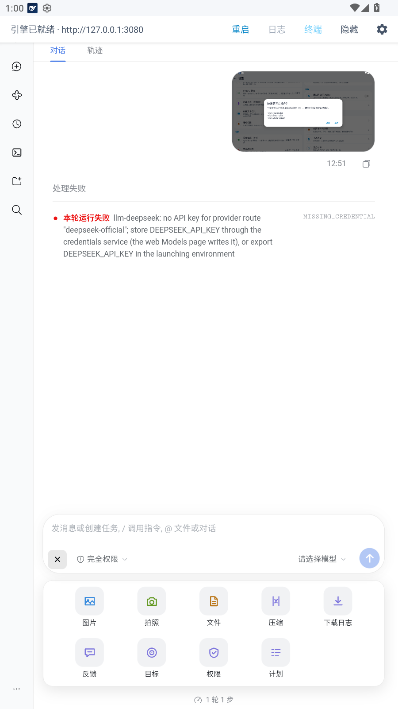
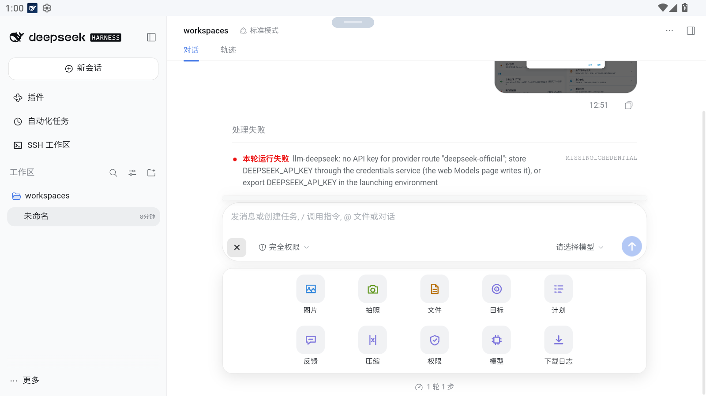

# dsh-mobile-compose

[](https://github.com/XiaoPb/dsh-mobile-compose/actions/workflows/ci.yml)
[](https://github.com/XiaoPb/dsh-mobile-compose/actions/workflows/release.yml)
[](https://www.npmjs.com/package/@xiaopb/dsh-mobile-compose)
[](LICENSE)

DSH 网页界面插件：**手机端输入体验** —— 把输入框左下角的「添加文件」「调用指令」收编为一个「＋」入口，点击弹出 **QQ 式动作面板**（宫格瓦片，插在输入框正下方、与其等宽；所有窗口宽度表现一致；返回键 / Esc / 点击面板外关闭）。展开时「＋」旋转为「×」，再点或 Esc 关闭。面板动作按**文件来源细分**（相册 / 拍照 / 文档 / 指令），为安卓专门路由预留标准缝；选中的文件全部回流**官方上传通道**（校验 / 上传 / 附件预览零重复）。

当前版本 0.6.x：**指令/技能全量接入官方 RPC**（单列表自动分页、每条指令专属图标、**文案跟随 DSH 语言**、单行等高瓦片）、**执行决策表对齐原生菜单**（带参数的指令只写草稿不代发；裸指令走官方 Enter 通道分离执行）、**面板 dock 化且独占一行**（不与进度等条目挤兑）、**DSH 设置页配置项**（动作开关 / 隐藏原生按钮 / 隐藏指令，改动实时生效）与**安卓端对接契约**（[docs/android-bridge.md](docs/android-bridge.md)）。

## 效果预览

**移动端（MuMu 模拟器，390×844 逻辑宽）** —— 面板插在输入框正下方、与其等宽，展开时「＋」已旋转为「×」；瓦片等高 72px、底部无提示行，条目超出一页时显示页码点（左右滑 / 滚轮换页）：



**桌面端（1280 宽）** —— 同一形态：面板仍插在输入框正下方、与其等宽（712px），不遮挡任何内容；常用动作（图片/文件）在最前，指令与技能紧随其后：



## 职责划分：插件做什么，外部做什么

| 职责 | 归属 | 说明 |
|---|---|---|
| 输入框「＋」入口、动作面板 UI、动画、返回键关闭 | **插件** | 全部走官方插槽（`conversation.input.left` + `conversation.composer.dock`），零 DOM 注入 |
| 动作注册表与来源标记（gallery/camera/document/internal） | **插件** | 面板宫格的单一事实来源 |
| 指令接管 | **插件** | 指令/技能目录来自官方 RPC（`remote.commands.list` / `remote.skills.list`），标签来自官方 locale + 原生菜单采集兜底（跟随 DSH 语言）；执行按**官方 dispatch 决策表**：带 `input` 的指令只把 `/token ` 写进草稿（用户补参数后自行发送），裸指令走 `setDraft('/x')+submit()` 官方 Enter 通道 |
| 桌面端文件选取 | **插件** | 图片 / 文件都是同一个 file 输入的两个视图：图片附**显式图片后缀过滤**（`image/png,image/jpeg,image/webp,image/gif,.png,.jpg,.jpeg,.webp,.gif`）；文件**不限后缀**（= 原始 file，处理全部类型） |
| 文件回流与上传 | **插件** | DataTransfer 注入官方隐藏 input → 官方 onPickFiles → addFiles 校验/上传/预览 |
| 动作能力协商 | **插件（宿主）** | `GET /api/dsh-mobile-compose/capabilities`，实时反映设置页配置 |
| 面板配置 UI | **插件（宿主）** | DSH 设置页 `dsh-mobile-compose` namespace，schema-form 自动渲染 |
| 错误 toast、加载态 | **插件** | 安卓端只返回结构化结果，不画 UI |
| 原生相机 / 相册 Intent、运行时权限、图片压缩 | **安卓端（外部）** | 按 [docs/android-bridge.md](docs/android-bridge.md) 注入 `window.DshComposeBridge` |
| 选取结果的回传 | **安卓端（外部）** | `{status, code, files:[{name, mime, size, width?, height?, data(base64)}]}`，契约见文档 §3 |

安卓端未实现（或 `routed:"web"`）时，一切照旧走浏览器方案——**安卓接入是渐进增强，不是门槛**。

## 安装

```sh
# 从 npm 安装（推荐）
dsh plugin --profile web add @xiaopb/dsh-mobile-compose

# 本地路径安装（开发验证）
dsh plugin --profile web add /path/to/dsh-mobile-compose

# 固定到某个 Release 的 tarball（离线）
dsh plugin --profile web add /path/to/xiaopb-dsh-mobile-compose-0.6.4.tgz

# 之后重启引擎（bundle 插件不热加载）
```

装好后打开桌面端 web GUI：输入框左下角出现「＋」按钮；原生「添加文件（回形针）」「调用指令」按钮默认隐藏（可在设置页关闭）。

## 桌面端验证清单

1. 宽窗口点击「＋」→ **对话框卡片正下方**展开 dock 面板（文档流内，不遮挡任何内容）；「＋」位于工具行**最左**（原「添加文件」的位置）；
2. 单一列表：常用动作在最前，指令/技能紧随其后；宫格列数随面板宽度自适应，放不下自动生成页码点（可点；**移动端左右滑**、**桌面端鼠标滚轮**换页）；
3. 「图片」→ 原生文件打开器弹出且**默认过滤到图片类型**（显式后缀 accept）；选 1-2 张 → 附件预览条出现、走官方上传（进度 / receipt）；
4. 「文件」→ 原生文件打开器（不限后缀，即原始 file）；
5. 指令瓦片与动作同列：RPC 全量目录 + **单行标签**（中文或英文，跟随 DSH 语言；所有瓦片等高 72px，卡片底部无提示行，斜杠别名只在悬停 title 里）；点带参数的指令（如 /goal）→ 只插入 `/目标 ` 到聊天框（**不发送**，与原生菜单一致）；点裸指令（如 /compact）→ 官方 Enter 通道分离执行；
6. 把窗口缩到手机宽度（或 DevTools 设备模拟）→ 面板形态**不变**（仍插在输入框下方、与其等宽），Esc / 系统返回键 / 点击面板外关闭；
7. 设置页 → Plugins → dsh-mobile-compose：关掉任一动作 → 不重载页面，再点「＋」该瓦片已消失。

## 架构

```
web GUI ──▶ __ModuleLoader__ 装载 lib/client.js（closure factory，形状对齐 dsh-hardssh 客户端产物）
   ├─ ctx.slots 注册 conversation.input.left ←「＋」入口（flex order 最左 = 原生两键原位置）
   ├─ ctx.slots 注册 conversation.composer.dock ← 动作面板（对话框下方文档流内；
   │    所有窗口宽度表现一致；关闭 = Esc / 系统返回键 / 点击面板外）
   ├─ 面板 = 单一列表自动分页（页码点 + 移动端左右滑 / 桌面滚轮）；宫格列数随宽度自适应
   ├─ 动作注册表：pick-image(相册) / take-photo(拍照) / pick-file(文档) / command(指令)
   │    每项带 source 标记（gallery/camera/document/internal）——安卓专门路由的缝
   ├─ 指令接管：RPC 全量目录为权威；原生菜单采集（visibility:hidden）仅补标签/顺序；
   │    执行 = 官方 dispatch 决策表（input→claim 写草稿不代发；裸指令→setDraft+submit）
   │    （官方裁决通道）；采集失败回退原生菜单点选
   ├─ 桌面：图片动作 = 自带 input + 显式图片后缀 accept（原始文件打开器按类型过滤）；
   │        文件动作 = 自带 input、accept 留空（全部后缀，即原始 file）
   ├─ 文件回流：DataTransfer 注入官方隐藏 input[type=file] → 派发 change
   │    → 官方 onPickFiles → addFiles 校验/上传/预览全链路原样生效
   └─ 能力协商：每次打开面板拉取 GET /api/dsh-mobile-compose/capabilities（失败走内置默认集）

宿主端（lib/index.js，cordis 插件）
   ├─ GET /api/dsh-mobile-compose/capabilities（动态 inject webServer，实时读设置页来源）
   └─ dsh-mobile-compose 设置页 namespace（ctx.settings.installSection + schemastery schema，
      DSH 设置页 schema-form 自动渲染；settings 服务缺席时静默降级为插件装载配置）
```

**原生按钮隐藏原理**（零 DOM 改动，插件样式卸载即恢复）：

```css
/* 调用指令按钮：aria-haspopup="listbox" 是它在工具行里的稳定标识 */
body.dmc-hide-native button[aria-haspopup="listbox"]{display:none!important}
/* 添加文件按钮：紧跟官方隐藏 input[type=file][multiple][hidden] 的那个按钮 */
body.dmc-hide-native button:has(+ input[type="file"][multiple][hidden]:not([data-dmc-input])){display:none!important}
```

## 安卓专门路由（外部工作，契约见 docs/android-bridge.md）

- 插件已备好**接缝**：`capabilities` 响应的 `routed` 字段 + `window.DshComposeBridge` 桥协议 + 结构化返回/错误码 + 失败自动回退 web 路径；
- 安卓端需要完成：WebView 注入桥、take-photo/pick-image 路由到原生 Intent、运行时权限、图片压缩、base64 回传（全部要求在 [docs/android-bridge.md](docs/android-bridge.md) §2–§5）；
- 安卓运行时探测与 dsh-hardssh 同约定（`ANDROID_DATA` / `DSH_ANDROID_USER_DATA` / `/system/build.prop`），capabilities 响应里的 `platform.android` 已就绪——客户端用它决定「拍照」瓦片只在安卓展示。

## 配置

**推荐入口：DSH 设置页**（实时生效，落盘持久化）。插件装载配置仅作初始默认。

| 键 | 默认 | 说明 |
|---|---|---|
| `enabled`（仅装载配置） | `true` | `false` 时装载但零路由，客户端走内置默认动作集 |
| `hideNativeButtons` | `true` | 隐藏原生「添加文件 / 调用指令」小按钮；`false` 时两套入口并存 |
| `actions.pick-image` | `true` | 相册动作开关 |
| `actions.take-photo` | `true` | 拍照动作开关（仅安卓运行时展示） |
| `actions.pick-file` | `true` | 文件动作开关 |
| `actions.command` | `true` | 指令动作开关 |
| `hiddenCommands` | `file` | 不展示的指令名（逗号分隔，不带斜杠）。`/file` 是官方「添加文件」指令，与图片/文件瓦片重复，默认剔除；清空 = 全部展示 |

## CI/CD

| 工作流 | 触发 | 做什么 |
|---|---|---|
| [`ci.yml`](.github/workflows/ci.yml) | push `main` / PR / 手动 | Node 22 与 24 矩阵：`npm ci` → `npm run check`（35 项单测 + 离线冒烟 + 包契约自检）→ `npm pack --dry-run` → 打 tarball → 校验发布说明生成器 → **消费端安装测试**（干净目录安装 tarball，校验 `dsh.bundle.patch` / `dsh.client.platform` / 宿主 `apply` 可加载 / 开发目录未混入包） |
| [`release.yml`](.github/workflows/release.yml) | push `v*` tag / 手动 | 校验 tag ↔ `package.json` 版本 → 自检 → 发布 npm（`scripts/publish-npm.sh`：优先 **Trusted Publishing**／OIDC，版本未真正公开时回退 **`NPM_TOKEN`**；每种方式都「发布 + 轮询确认公开」，`--provenance` 失败自动降级重试）→ 确认版本已在 npm 公开 → `npm pack` + SHA-256 → 生成发布说明（`scripts/release-notes.sh`）→ 创建 GitHub Release（附 tarball 与校验和） |
| [`release.yml`](.github/workflows/release.yml) | push `v*` tag / 手动 | 校验 tag ↔ `package.json` 版本 → 自检 → 发布 npm（`scripts/publish-npm.sh`：**Trusted Publishing**／OIDC 优先，版本未真正可见时回退 **`NPM_TOKEN`**；每次尝试都「发布 + 轮询确认可见」，冲突不重发，`--provenance` 失败自动降级）→ `npm pack` + SHA-256 → 生成发布说明（`scripts/release-notes.sh`）→ 创建 GitHub Release（附 tarball 与校验和） |
| [`ui-verify.yml`](.github/workflows/ui-verify.yml) | 手动 / 每天 04:00（UTC+8） | 真机验收：用真实 DSH 引擎跑 `diag-browser`（面板全流程）、`verify-paging`（左右滑 / 滚轮）、`verify-decision`（`/goal` 只写草稿）、`verify-lang`（zh ↔ en）。`dsh_url` 留空时 CI 自建引擎并把本仓库装进 web profile；也可传入局域网引擎地址 |

发布一个版本：

```sh
npm version patch          # 或 minor / major，自动改 package.json 并打 v* tag
git push origin main --follow-tags
# → Release 工作流接管：npm 发布 + GitHub Release（产物与 SHA-256）
```

**npm 发布凭据**：默认走 Trusted Publishing（在 npm 包设置里登记本仓库 + `release.yml`，允许 `id-token: write`，无需 secret）；**版本没真正可见时自动回退**仓库 Secret `NPM_TOKEN`（需是可发布的 granular token：不能 stage-only / read-only，allowed packages 要包含本包）。两种方式都会带 `--provenance`，provenance 单独失败时自动降级重试。
**发布有个坑**：`npm publish` 成功后 registry 的**读路径（CDN）要 60~180s 才可见**，早期版本只等 30s 就判失败（0.6.4 / 0.6.5 的 tag 发布都因此误报，其实都发布成功了）。现在 `scripts/publish-npm.sh` 默认窗口 18×10s，并用带 cache-buster 的精确版本端点提前确认；registry 回「已存在该版本」时不再换方式重发、只延长等待。
**发布排查**：脚本失败时会打印 `npm whoami`、registry 该版本的 status、`npm stage list` 与 npm 报错原文；本地复现可用 `PACKAGE_NAME=... VERSION=... PROBE_REGISTRY=0 bash scripts/publish-npm.sh`（无凭据时只会走诊断分支）。
**本机跑真机验收**：`DSH_URL="http://127.0.0.1:3080/?token=..." node tools/diag-browser.js`（其余脚本同理，见 `npm run verify:paging` / `verify:lang`）。

## 验证

```sh
npm run check   # 一条命令跑完下面三项（CI 与 Release 用的同一入口）
npm test        # 单测（node:test，35 项：config / capabilities / 宿主接线含设置页 / jsdom 客户端行为 / 发布脚本）
npm run smoke   # E2E 冒烟：真实 HTTP 往返 + 客户端产物形状 + patch 形状
node scripts/verify-package.mjs   # 包清单 / cordis patch / bundle 契约 / 宿主导出 / CHANGELOG 版本
```

客户端 bundle 在 **jsdom 里真实执行**（加载契约 → apply 接线 → 渲染 → tab 切换 → 指令采集与官方通道执行 → 窄窗口统一 dock 形态 → 卸载清理），不依赖人工点检。

真实引擎验证（dsh 0.2.1-rc.4 已做过一轮）——

- `GET /api/dsh-mobile-compose/capabilities` 返回正确 JSON（`platform.android:false`）；
- 页面 roster 引用 `/plugins/@xiaopb/dsh-mobile-compose/client.js` 且内容完整（含全部新特性标记）；
- 引擎日志无本插件相关报错。

## 已知风险与验证点

- **DOM 标识漂移**：隐藏规则与文件回流依赖官方输入框的 DOM 结构（`aria-haspopup="listbox"`、隐藏 file input 的相邻关系）。DSH 升级若改变结构，表现为「原生按钮复现 / 图片动作失效」，console 会有 `[dsh-mobile-compose] 未找到…` 警告——更新选择器即可；设置页 `hideNativeButtons=false` 可临时回退到两套入口并存。
- **React change 去重**：文件注入已置空 `_valueTracker` 规避同值去重（jsdom 测试覆盖注入派发路径）。
- **`:has()` 选择器**：需要 Chrome/WebView 105+；旧 WebView 上表现为原生按钮保留（功能不受影响）。
- 「调用指令」走程序化点击官方按钮（其菜单由官方包内部件管理，不从外部重建）；若点击无响应，设置页回退方案同上。

## 许可

MIT。
